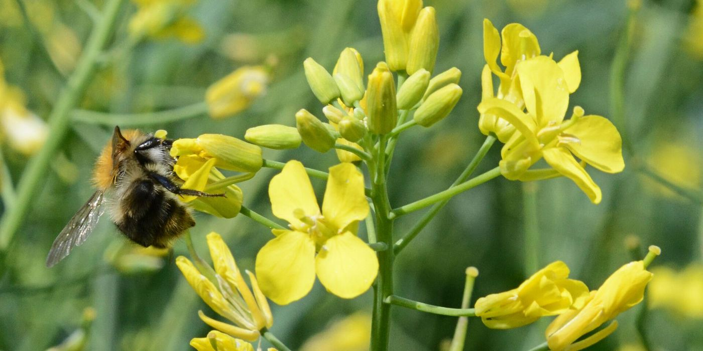
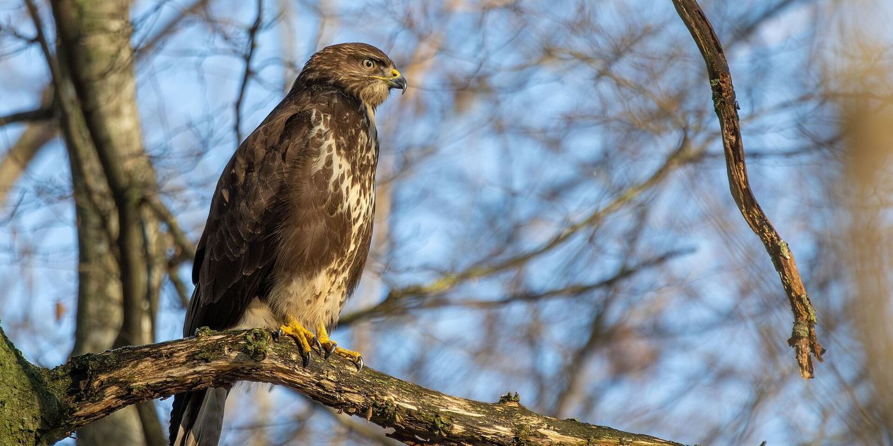

::: {.lead}
Regulators, policymakers and governments need evidence about which chemicals cause the most harm, where and to what, and whether the measures they take are working. For more than sixty years, UKCEH science has provided that evidence and has led directly to regulatory action to reduce chemical pollution.
:::

## From evidence to action

### Organochlorine insecticides {.case}

{.case-photo .nolightbox fig-alt="A sparrowhawk perched on a branch, preening its fanned tail"}

[1960s]{.label}

**Evidence.** In the 1960s, research at Monks Wood linked organochlorine insecticides such as DDT and dieldrin, and organomercury fungicides, to declines in birds of prey. The [Predatory Bird Monitoring Scheme](monitoring.qmd#predatory-bird-monitoring-scheme), established in 1962, measured these chemicals in birds and their eggs.

**Action.** This evidence contributed to these chemicals being banned from farming in Britain and elsewhere. Monitoring then showed residues falling in birds and eggs, confirming that the bans were working.

### Neonicotinoid insecticides {.case}

{.case-photo .nolightbox fig-alt="A bumblebee visiting yellow oilseed rape flowers"}

[2016–2018]{.label}

**Evidence.** A UKCEH-led analysis of 18 years of national records for 62 wild bee species [linked neonicotinoid use on oilseed rape to long-term population declines](https://doi.org/10.1038/ncomms12459). Species that forage on oilseed rape were affected three times more than other species. In 2017, a UKCEH-led field experiment across the UK, Germany and Hungary [found that neonicotinoid-treated crops harmed honeybees and wild bees](https://doi.org/10.1126/science.aaa1190), although effects varied between countries.

**Action.** In late 2017, the UK's Expert Committee on Pesticides advised ministers that the UKCEH field study "significantly adds to the evidence base", and that the risk to pollinators was greater than previously thought. In April 2018, EU member states, including the UK, voted to ban all outdoor uses of the neonicotinoids clothianidin, imidacloprid and thiamethoxam. The [National Honey Monitoring Scheme](monitoring.qmd#national-honey-monitoring-scheme) continues to track neonicotinoid residues in the environment after the ban.

### Anticoagulant rodenticides {.case}

{.case-photo .nolightbox fig-alt="A barn owl flying towards the camera against a blue sky"}

[2016 onwards]{.label}

**Evidence.** The Predatory Bird Monitoring Scheme has measured second-generation anticoagulant rodenticides in barn owls since 1983, showing how widely these rat poisons pass through food chains to non-target wildlife.

**Action.** Since 2016, the scheme has reported annually on rodenticides in barn owls for the UK Rodenticide Stewardship regime, which aims to reduce risks to wildlife. Its data were used in the regime's five-year review.

### Lead ammunition {.case}

{.case-photo .nolightbox fig-alt="A common buzzard perched on a bare branch"}

[2021–2029]{.label}

**Evidence.** The Predatory Bird Monitoring Scheme analysed lead in 220 common buzzards found dead between 2007 and 2018. Lead isotope analysis showed that 57% of the lead in their livers came from shotgun pellets, rising to 89% in birds with the highest exposure. This study and PBMS data on sparrowhawks were cited in the Health and Safety Executive's assessment of the risks of lead ammunition under UK REACH.

**Action.** In July 2025, the UK Government announced a ban on lead ammunition. The sale and use of lead shot and large-calibre lead bullets for live quarry shooting will end on 1 April 2029.

### Acid rain and air pollution {.case}

{.case-photo .nolightbox fig-alt="Lochnagar, an upland loch in the Cairngorms, seen from the surrounding rocky slopes"}

[1990s onwards]{.label}

**Evidence.** UKCEH hosts the UK National Focal Centre for critical loads, which calculates and maps the levels of acid and nitrogen deposition that UK habitats can tolerate without harm. These maps underpin UK policy on acidification and eutrophication, and the UK's contribution to international agreements such as the Gothenburg Protocol, which set national emission ceilings for sulfur dioxide, nitrogen oxides and ammonia.

**Action.** As emissions have fallen, the area of acid-sensitive UK habitats receiving more acid deposition than they can tolerate fell by 28.5% between 1995 and 2014. Long-term monitoring of upland lakes and streams shows that their water chemistry is recovering.

## Assessing policy options

Before acting, decision-makers need to know which measures will reduce pollution the most, in which parts of the environment, and at what cost. UKCEH links models of chemical emissions, environmental fate and exposure, so that policy options can be compared before they are put in place.

### Example: intentionally added microplastics

[Defra option appraisal · 2025]{.label}

Microplastics are intentionally added to many products, from detergents and cosmetics to the rubber infill used on synthetic sports pitches. Unlike microplastics from tyre wear or textiles, these can be controlled at source. For a Defra [option appraisal](https://sciencesearch.defra.gov.uk/ProjectDetails?ProjectId=21802) supporting UK REACH, UKCEH and [Economics for the Environment Consultancy](https://www.eftec.co.uk/) (eftec) estimated UK emissions, exposure, risk and impacts of intentionally added microplastics to 2043. They then compared six options for reducing them, with the results [published in *Integrated Environmental Assessment and Management*](https://doi.org/10.1093/inteam/vjag103).

::: {.stat-grid}
::: {.stat}
160,000 t

Intentionally added microplastics used in the UK, 2024–2043
:::

::: {.stat}
50,000 t

Emitted to the environment over the same period
:::

::: {.stat}
6

Policy options compared, from broad restrictions to targeted measures
:::

::: {.stat}
£9/kg

Cost of the most cost-effective option: containing sports pitch infill
:::
:::

The [UTOPIA model](https://github.com/microplastics-cluster/UTOPIA_model) traced emissions from products to soils, rivers and seas. Synthetic sports surfaces were the largest single source. Because about 99% of microplastics reaching wastewater treatment are retained in sewage sludge, and most sludge is spread on farmland, agricultural soils receive the most overall.

The six options fell into three groups:

- **Restrictions on use** (broad, targeted or aligned with the EU's REACH restriction) gave the largest reductions in exposure across the environment, but at an average cost of £261–601 million per year. *RMO 1A–1C*.
- **Containment measures on synthetic sports pitches** reduced exposure from sports surfaces as much as the restrictions did, for about £6 million per year. This was the most cost-effective option. *RMO 2*.
- **Reducing the amount of sewage sludge spread on land**, by 95% or 50%, mainly benefited agricultural soils, at £10–60 million per year. It would also reduce soil exposure to other contaminants in sludge, such as pharmaceuticals. *RMO 3A–3B*.

, CC BY 4.0.](assets/images/microplastics-options.png){fig-alt="Heatmap of exposure reduction from 0 to 90 percent for six options across marine, freshwater, freshwater sediment, urban soil and agricultural soil. Use restrictions give the largest reductions, up to about 75 percent in freshwater sediment. Sports pitch containment gives about 50 percent in urban soil. Sludge options mainly reduce agricultural soil exposure, by up to about 20 percent."}

No single option was best on every measure, but combining them, for example by containing sports pitch infill alongside a targeted restriction, could achieve most of the benefit at much lower cost. Defra is considering the findings, which will guide future decisions under UK REACH.

::: {.photo-credits}
Case study photos from Wikimedia Commons, cropped: [sparrowhawk](https://commons.wikimedia.org/wiki/File:Sparrowhawk_-_Accipiter_nisus_2.jpg) by Caroline Legg, [CC BY 4.0](https://creativecommons.org/licenses/by/4.0/); [bumblebee on oilseed rape](https://commons.wikimedia.org/wiki/File:Brassica_napus_Bombus_pascuorum,_koolzaad_boomhommel_(1).jpg) by Rasbak, [CC BY-SA 3.0](https://creativecommons.org/licenses/by-sa/3.0/); [barn owl](https://commons.wikimedia.org/wiki/File:Front_view_of_a_barn_owl_-_Tyto_alba_-_in_flight.jpg) by Dannymoore1973, [CC0](https://creativecommons.org/publicdomain/zero/1.0/); [common buzzard](https://commons.wikimedia.org/wiki/File:Common_buzzard_2024-01-20.jpg) by Alexis Lours, [CC BY 4.0](https://creativecommons.org/licenses/by/4.0/); [Lochnagar](https://commons.wikimedia.org/wiki/File:Dark_Lochnagar_-_geograph.org.uk_-_8019192.jpg) by Scott Cormie, [CC BY-SA 2.0](https://creativecommons.org/licenses/by-sa/2.0/).
:::

[Back to UKCEH at IC1](index.qmd){.cta}
