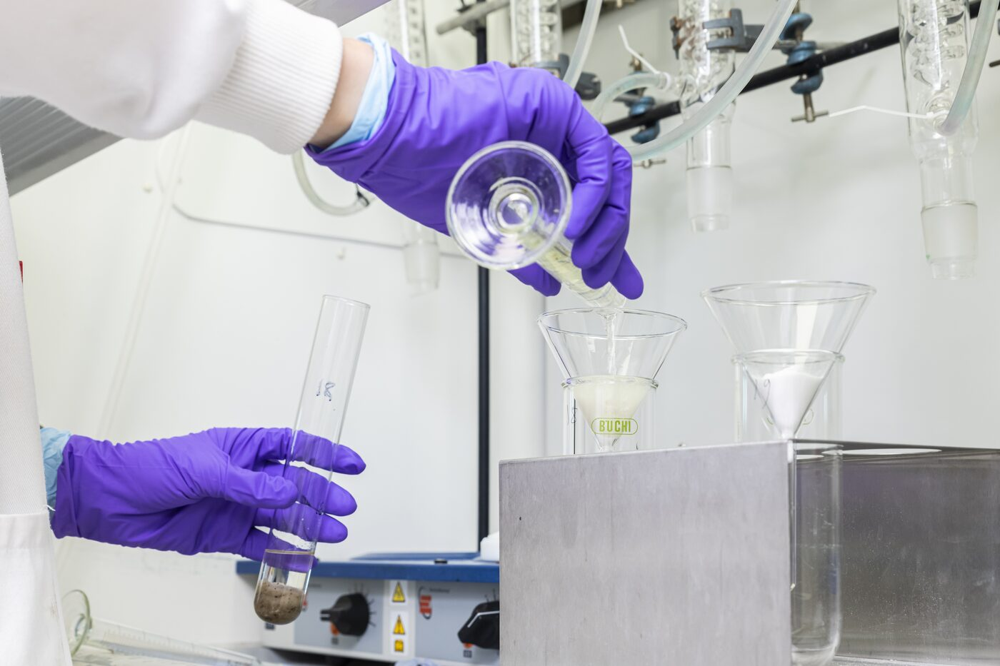
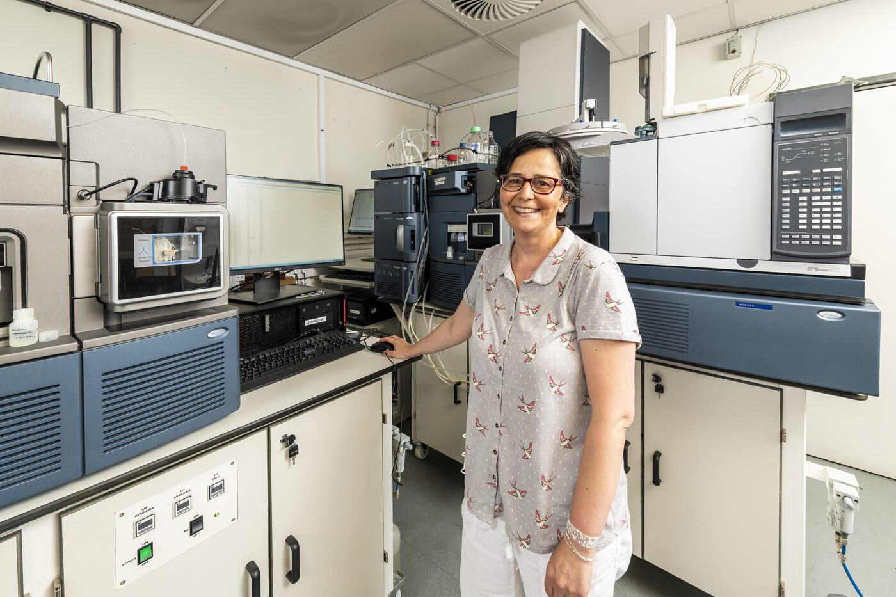
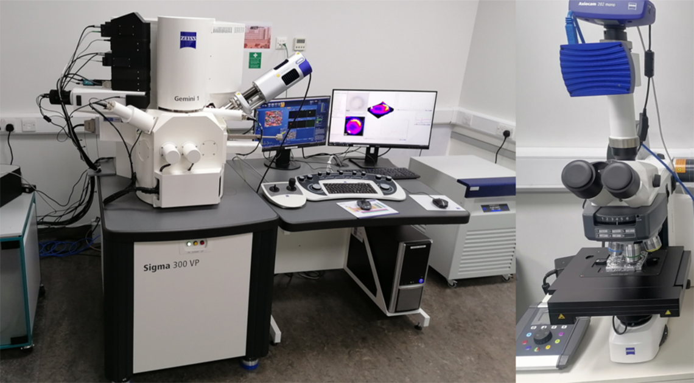
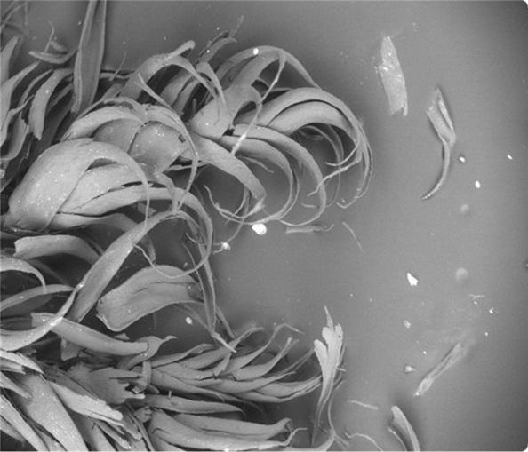

::: {.lead}
Turning the Global Framework on Chemicals into measurable progress requires reliable evidence of chemical pollution. UKCEH's laboratories provide that evidence, from measuring trace levels of chemicals in water, soil and wildlife to imaging individual particles at the nanoscale.
:::

## Analytical Chemistry laboratories

UKCEH's analytical chemistry laboratories in Lancaster measure a wide range of pollutants in soil, sediment, water and biological samples. Our data underpin environmental monitoring and chemical risk assessment, helping policymakers, regulators and partners understand where contamination occurs and whether the remediation measures put in place are proving effective.

::: {.photo-pair}
{.photo fig-alt="Gloved hands pour a liquid sample through a glass funnel, holding a test tube containing a soil sample, with glass condensers hanging above the bench."}

{.photo fig-alt="A smiling scientist stands in a laboratory between banks of chromatography and mass spectrometry instruments, with a computer and keyboard on the bench beside her."}
:::

### Chemicals we measure

- **PFAS ("forever chemicals").** Quantitative analysis of approximately 50 compounds, including carboxylic acids, sulfonic acids, sulfonamides, fluorotelomers and emerging PFAS.
- **Chemicals in plastics.** Plasticisers and tyre additives such as 6PPD, measured alongside plastic particles to give a fuller picture of plastic-related pollution.
- **Organic contaminants.** Persistent organic pollutants, pesticides, pharmaceuticals and emerging environmental contaminants.
- **Metals and metalloids.** Trace measurements in environmental samples to support pollution monitoring and assessment.
- **Stable isotopes.** Isotopic analysis to support studies of environmental processes and sources.

### Finding what we weren't looking for

Alongside targeted analysis of known chemicals, we use non-target screening (a broad scan for unexpected or unidentified substances) to detect chemicals of growing concern, including novel and emerging PFAS, pharmaceuticals, pesticides and other chemicals.

### Quality you can rely on

Our laboratories are UKAS-accredited to ISO/IEC 17025:2017 and operate rigorous quality assurance, sample tracking and contamination control, so you can have confidence in the measurements that inform monitoring and decisions.

### Supporting international and national programmes

We contribute to many international and national programmes, helping to track progress, identify emerging risks and inform action on chemical pollution. These include:

- [PARC](https://www.eu-parc.eu/), the European Partnership for the Assessment of Risks from Chemicals
- Short-chain PFAS inter-laboratory studies
- The [National Honey Monitoring Scheme](monitoring.qmd#national-honey-monitoring-scheme), through Defra's BEECH project
- The [Predatory Bird Monitoring Scheme](monitoring.qmd#predatory-bird-monitoring-scheme)
- The Chemicals Investigations Programme (CIP)

### Work with us

To discuss analysis for your project or monitoring programme, contact [enquiries@ceh.ac.uk](mailto:enquiries@ceh.ac.uk).

## CoreMiS

{.photo fig-alt="A Zeiss scanning electron microscope with attached Raman spectroscopy modules and two computer screens showing spectral images, next to a Zeiss light microscope with a camera mounted on top."}

The [Centre for Multimodal Correlative Microscopy and Spectroscopy (CoreMiS)](https://www.ceh.ac.uk/solutions/laboratory-services/uk-centre-multimodal-correlative-microscopy-and-spectroscopy-advanced-environmental-science) is the first platform in the UK dedicated to micro-spectroscopic analysis of environmental samples by Raman Imaging and Spectroscopy with Scanning Electron Microscopy and Energy Dispersive X-ray Spectroscopy (RISE-EDS).

RISE-EDS allows us to see in tiny detail chemical reactions in water, atmosphere, soil and plants.

Despite the recognition of the common importance of nanoscale phenomena for governing the behaviour of pollutants, scientists to date have relied on measurements made in bulk or, at best, at the microscale to infer these critical nanoscale processes. Without nanoscale understanding, it will remain challenging to identify, understand and manage exposure to environmental pollutants and the resulting health and ecological impacts.

## The Microplastics Analysis Facility

The purpose of the [Microplastics Analysis Facility](https://www.ceh.ac.uk/solutions/laboratory-services/microplastics-analysis) is to detect the presence of plastics in the environment so that researchers can understand their fate, bioavailability and interactions with wildlife. This research helps governments, consumers and industry to tackle the growing pollution and harm caused by plastic litter and microplastic particles in the environment – in our soils, freshwaters, oceans and food chains.

{.photo fig-align="left" fig-alt="A greyscale electron microscope image of curled moss leaves, with small particles scattered on the surface beside them."}

The facility has undertaken work across public and private sectors investigating the prevalence of microplastics in our natural world. For example, we identified the [widespread deposition of](https://www.ceh.ac.uk/news-and-media/blogs/microplastics-taken-breeze-found-mosses-across-uk) [microplastics from the air](https://doi.org/10.1186/s43591-026-00191-8) across rural areas of the United Kingdom, as part of the Working Group on Effects (WGE) of the Convention on Long-range Transboundary Air Pollution (LRTAP). Baseline assessments such as this, and our work investigating microplastics in the UK water industry, are essential in tracking progress against societal, government and industry priorities, to reduce the emissions and potential harm of plastics and microplastics in the environment.

[Back to UKCEH at IC1](index.qmd){.cta}
