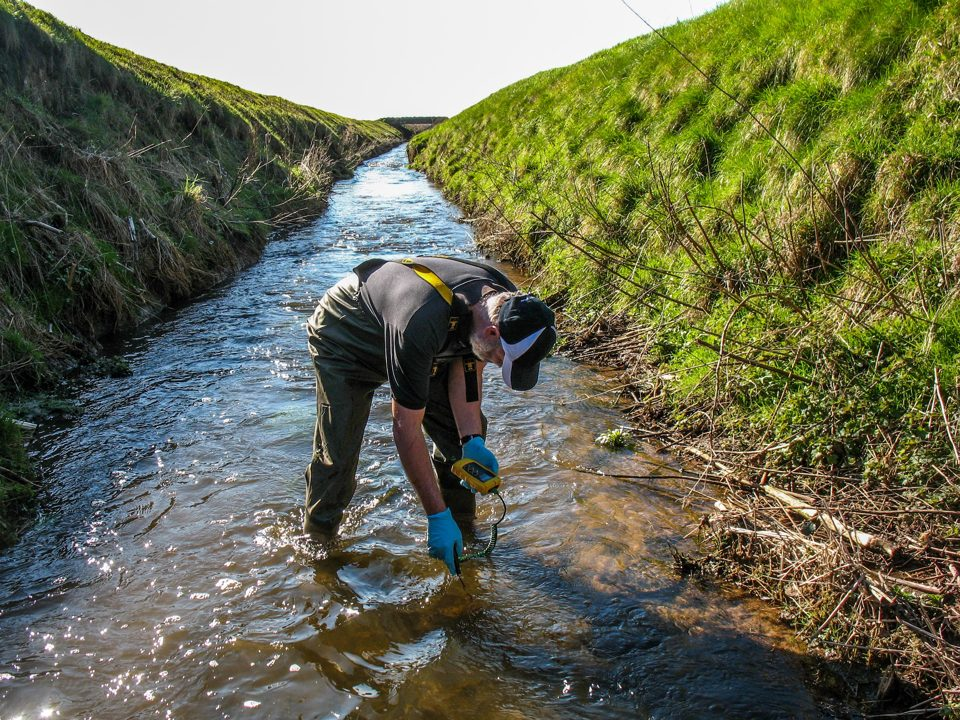
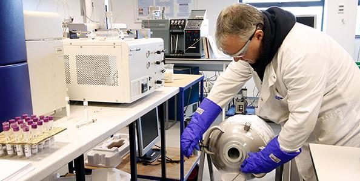
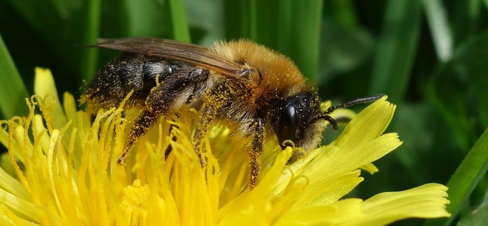

## About

::: {.lead}
The UK Centre for Ecology & Hydrology is taking part in the first International Conference of the Global Framework on Chemicals (IC1). Join us at the [Action and Partnerships Hub](https://www.unep.org/en/global-framework-chemicals/international-conference-1/action-and-partnership-hub) to discover how our scientists bring long-term environmental monitoring, chemical risk assessment and pollution modelling to the conversation, helping to turn the Framework's targets into measurable progress and actionable insights on the ground.
:::

Healthy environments underpin healthy economies, resilient communities and sustainable growth. Yet understanding whether actions to address pollution are working requires robust evidence that connects data and understanding across air, water, soil and wildlife. The UK Centre for Ecology & Hydrology (UKCEH) works with governments, international organisations and partners to generate, integrate and interpret environmental evidence that supports decision-making on chemicals and pollution.

## Find Out More

::: {.link-grid}
::: {.link-card}
{.link-card-photo fig-alt=""}

[Monitoring]{.label}

[[Monitoring chemicals in the environment](#)]{.link-card-title}

How long-term monitoring data can track progress against the Framework's targets.
:::

::: {.link-card}
{.link-card-photo fig-alt=""}

[Laboratories]{.label}

[[Advanced chemical analysis](#)]{.link-card-title}

UKCEH Analytical Chemistry labs provide high-quality data across a range of contaminants and matrices.
:::

::: {.link-card}
{.link-card-photo fig-alt=""}

[Policy]{.label}

[[Prioritising actions](#)]{.link-card-title}

Integrated modelling and monitoring to assess the effectiveness of policy options and interventions in reducing pollution.
:::

::: {.link-card}
{.link-card-photo fig-alt=""}

[Data]{.label}

[[Environmental Information Data Centre](#)]{.link-card-title}

Open datasets on chemicals, pollutants and their effects on ecosystems.
:::

:::
