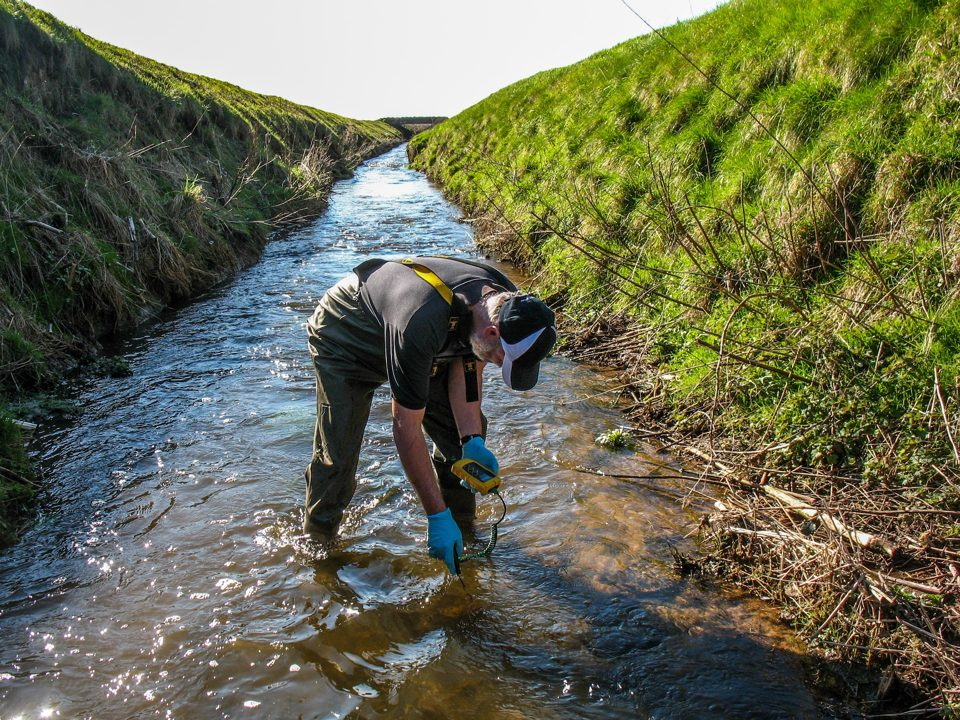
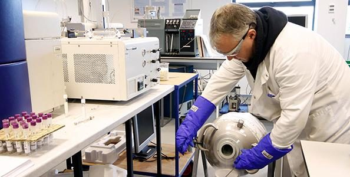
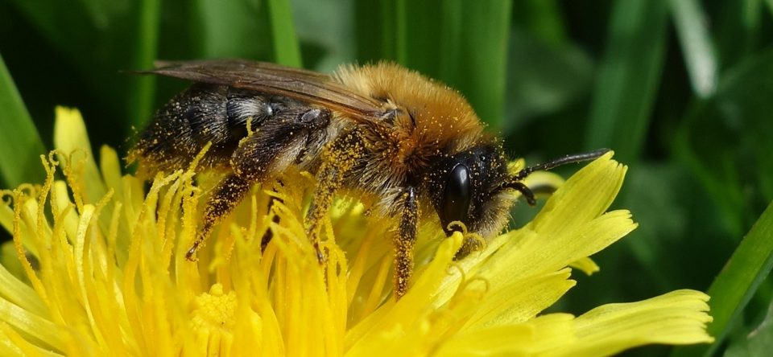

## About

::: {.lead}
The UK Centre for Ecology & Hydrology is an independent, not-for-profit, environmental science organisation that ensures society understands how the environment is changing and what that means for people and nature. Through our science, data, and partnerships, we work across the UK and globally to turn evidence into better decisions, actions and a more resilient future.
:::

We are taking part in the first International Conference of the Global Framework on Chemicals (IC1). Join us at the [Action and Partnerships Hub](https://www.unep.org/en/global-framework-chemicals/international-conference-1/action-and-partnership-hub) to discover how our scientists bring long-term environmental monitoring, chemical risk assessment and pollution modelling to the conversation, helping to turn the Framework's targets into measurable progress and actionable insights on the ground.

Healthy environments underpin healthy economies, resilient communities and sustainable growth. Yet understanding whether actions to address pollution are working requires robust evidence that connects data and understanding across air, water, soil and wildlife. The UK Centre for Ecology & Hydrology (UKCEH) works with governments, international organisations and partners to generate, integrate and interpret environmental evidence that supports decision-making on chemicals and pollution.

## Find Out More

::: {.link-grid}
::: {.link-card}
{.link-card-photo fig-alt=""}

[Monitoring]{.label}

[[Monitoring chemicals in the environment](monitoring.qmd)]{.link-card-title}

How long-term monitoring data can track progress against the Framework's targets.
:::

::: {.link-card}
{.link-card-photo fig-alt=""}

[Laboratories]{.label}

[[Advanced chemical analysis](analysis.qmd)]{.link-card-title}

UKCEH Analytical Chemistry labs provide high-quality data across a range of contaminants and matrices.
:::

::: {.link-card}
{.link-card-photo fig-alt=""}

[Policy]{.label}

[[Prioritising actions](actions.qmd)]{.link-card-title}

Integrated modelling and monitoring to assess the effectiveness of policy options and interventions in reducing pollution.
:::

::: {.link-card}
{.link-card-photo fig-alt=""}

[Data]{.label}

[[Environmental Information Data Centre](https://eidc.ceh.ac.uk)]{.link-card-title}

Open datasets on chemicals, pollutants and their effects on ecosystems.
:::

:::

## Work with us

UKCEH will be in Geneva for IC1, 16–20 November 2026. We welcome conversations with governments, international organisations, researchers and industry about environmental monitoring, chemical analysis and modelling to support the Global Framework on Chemicals. Speak to our delegation at the conference, or contact us at any time.

[Email enquiries@ceh.ac.uk](mailto:enquiries@ceh.ac.uk){.cta}

### Our delegation

::: {.team-list}
::: {.person}
{.person-photo fig-alt="Sam Harrison"}

::: {.person-body}
[Sam Harrison]{.person-name} [Environmental Modeller]{.person-role}

Sam is an environmental modeller who specialises in developing software and tools to predict the emissions, exposure, risks and impacts of chemicals in the environment. A Fellow of the Institute for Research Software, he brings digital innovations to environmental science for better joined-up understanding of the complex interactions of society and the natural world.

[UKCEH profile](https://www.ceh.ac.uk/staff/samuel-harrison){.person-link aria-label="Sam Harrison's UKCEH profile"} [LinkedIn](https://www.linkedin.com/in/samharrison7/){.person-link aria-label="Sam Harrison on LinkedIn"}
:::
:::

::: {.person}
{.person-photo fig-alt="Richard Cross"}

::: {.person-body}
[Richard Cross]{.person-name} [Pollution Scientist]{.person-role}

Richard is Principal Investigator for the UKCEH Microplastics Analysis Facility, leading the development of new methods to detect and characterise micro- and nanoplastics in environmental samples. Richard's research explores the exposure and effects of particulate pollutants, with a focus on robust, reproducible methods that give policy decisions a sound evidence base. Richard also contributes to international standards for measuring microplastics in water through BSI and ISO committees.

[UKCEH profile](https://www.ceh.ac.uk/staff/richard-cross){.person-link aria-label="Richard Cross's UKCEH profile"} [LinkedIn](https://www.linkedin.com/in/richard-cross-9b281937a/){.person-link aria-label="Richard Cross on LinkedIn"}
:::
:::

::: {.person}
{.person-photo fig-alt="Heather Carter"}

::: {.person-body}
[Heather Carter]{.person-name} [Analytical Chemist]{.person-role}

Heather is an experienced analytical chemist working across nutrient and organic analysis of surface and ground waters, atmospheric gases, agricultural run-off, soils and wildlife. Specialising in persistent organic pollutants, Heather was integral to setting up UKCEH's methods for analysing polymers by pyrolysis, and for 6PPD, a marker of tyre wear.

[UKCEH profile](https://www.ceh.ac.uk/staff/heather-carter){.person-link aria-label="Heather Carter's UKCEH profile"} [LinkedIn](https://www.linkedin.com/in/heather-carter-a6b3b21a0){.person-link aria-label="Heather Carter on LinkedIn"}
:::
:::

::: {.person}
{.person-photo fig-alt="Glória Dos Santos Pereira"}

::: {.person-body}
[Glória dos Santos Pereira]{.person-name} [Head of Analytical Chemistry]{.person-role}

Glória leads UKCEH's Analytical Chemistry group and accredited laboratories who deliver high-quality data on chemicals in a range of environmental samples. Her research focuses on persistent organic pollutants and on identifying emerging contaminants that could pose a risk to the environment, wildlife and people, particularly how wild birds are exposed to contaminants through the food chain.

[UKCEH profile](https://www.ceh.ac.uk/staff/m-gl%C3%B3ria-dos-santos-pereira){.person-link aria-label="Glória Dos Santos Pereira's UKCEH profile"} [LinkedIn](https://www.linkedin.com/in/gl%C3%B3ria-pereira-959411a7/){.person-link aria-label="Glória dos Santos Pereira on LinkedIn"}
:::
:::
:::
